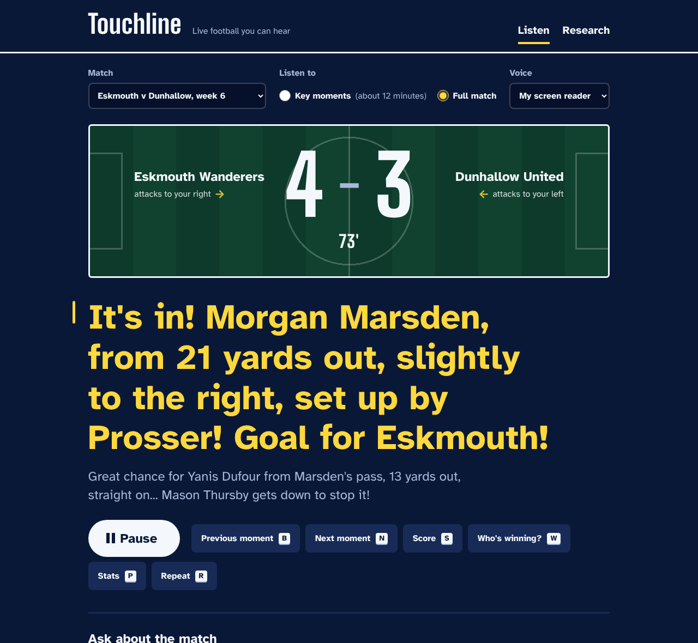
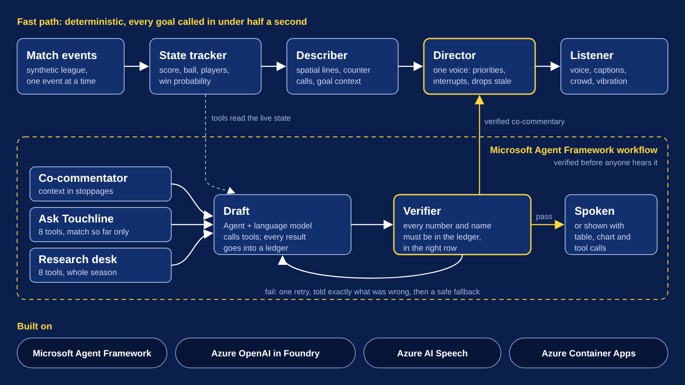
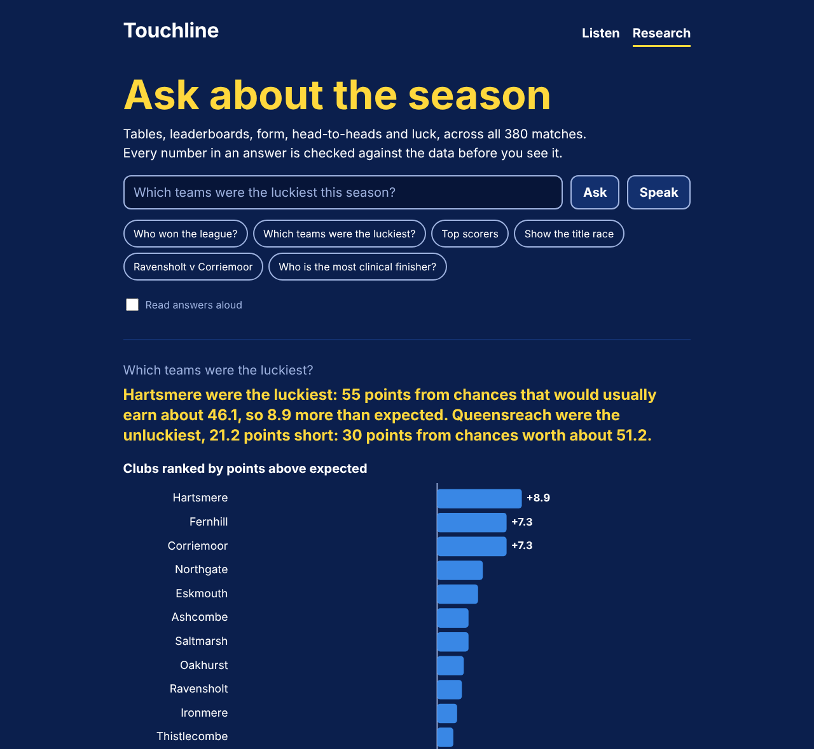

# Touchline: live football you can hear

Touchline is a live match companion for blind and low-vision fans, with a research desk for anyone who wants to dig into the season. A team of AI agents follows a football match event by event and turns it into spoken commentary you can follow by ear. It tells you where the ball is, who has it, which way it's going, and why the moment matters. Every goal is announced within half a second, and nothing it says is made up.

Built for the Microsoft × Premier League *Inside the Game* developer hackathon. All clubs, players and matches are fictional. They come from a synthetic league generator that is calibrated against real top-flight football ([docs/GENERATOR.md](docs/GENERATOR.md)).

**Demo video:** _link coming_ · **Live app:** [touchline.ambitiousisland-9c477573.eastus2.azurecontainerapps.io](https://touchline.ambitiousisland-9c477573.eastus2.azurecontainerapps.io) (the first visit after a quiet spell takes about 15 seconds to wake up)





## The problem

Television commentary assumes you can see the screen. "What a ball from him!" tells a blind fan nothing about where the ball went. Audio description exists in some stadiums, delivered by trained volunteers, but there's very little for fans watching at home, and nothing that adapts to the listener.

## What Touchline does

- **Spatial play-by-play.** "Strachan finds Dufour, inside the box, right side." Locations follow radio convention: the side of the pitch, how far out, the edge of the box.
- **A fixed mental map.** The home side always attacks to your right. The voice (with the neural voice) and the crowd sound are panned left or right to follow the ball.
- **A crowd you can read.** A synthesised crowd swells as an attack gets dangerous and roars for goals. On phones, goals also vibrate.
- **Ask Touchline anything.** Press A and ask out loud, or type: "How many shots have Dunhallow had since half-time?", "Who's been booked?", "How's Marsden doing?". An Agent Framework agent answers by calling tools that see the match only as it stands at that moment. The Verifier checks the answer before it's spoken.
- **Quick keys.** S for the score, W for who's likely to win, P for stats, L for where the ball is. These answer instantly from the live match state.
- **Key moments or the full match.** Highlights mode plays only the build-up to each big moment, with a short bridge line ("On to 63 minutes. Eskmouth 3, Dunhallow 2.").
- **Your screen reader, if you prefer.** "My screen reader" mode sends every line to an ARIA live region instead of speaking it, so NVDA, JAWS, VoiceOver or a braille display can read it.
- **Built for low vision too.** Yellow on navy, Atkinson Hyperlegible type (designed by the Braille Institute), large targets, full keyboard control, and support for reduced-motion and forced-colours settings.

## The research desk (`/research`)

A second page for broadcasters, analysts and curious fans. Ask about the whole season in plain English, by typing or speaking: "Which teams were the luckiest?", "Who's the most clinical finisher?", "Show the title race", "Ravensholt v Corriemoor". An Agent Framework agent picks from eight season tools:
- the table after any matchweek;
- player leaderboards (with a 900-minute floor for per-90 stats);
- player and club profiles;
- a club ranking by any stat, including points above expected;
- head-to-heads, results and position history.



Every answer arrives with its evidence: the agent's sentence, a chart chosen to fit the data (ranked bars, above-or-below-expected bars, or position lines), the full table, and a "How this was answered" panel listing the tool calls and the Verifier's decision. Follow-up questions keep the last three exchanges as context.

For tables, the Verifier is stricter. A number said next to a club or player must come from **that** club's or player's row, so "Queensreach were 41 points short" is rejected even though 41 appears elsewhere in the table.

## How the agents work

Six agents, two speeds. The fast path is deterministic, so a goal is called within half a second. The language-model agents run on **Microsoft Agent Framework** and only speak after the Verifier approves.

```
synthetic event stream ──► State tracker ──► Describer ──┐
   (one event at a time)    score, ball, players,         │  candidate lines
                            win probability               ▼
                                                      Director ──► timeline ──► player (voice, captions,
                            Colour agent ──► Verifier ──┘  one voice,                 crowd, haptics)
                            (LLM or templates)  checks every   priorities,
                                                number & name  interruptions
```

| Agent | Job | How |
|---|---|---|
| **State tracker** | What's true right now | Score, possession, ball location in two frames, players on the pitch, cards, and an in-play win probability built from season-to-date xG and the live score. |
| **Describer** | What just happened, in words | Template lines with spatial language, live counter-attack detection ("Dunhallow break!"), shot quality ("Big chance!"), and goal context ("his 4th goal of the season"). |
| **Director** | What gets said, and when | Speech is slower than football (about 2.5 words a second). The Director keeps a single voice, drops lines that are too old to help, lets urgent lines cut in, narrates the ball when nothing else is queued, and keeps quiet when play is dead. |
| **Colour agent** | Context in stoppages | An Agent Framework `Agent` on Azure OpenAI (Microsoft Foundry). It drafts a line from a fact pack built from the live state. Offline, it uses templates built from the same facts. |
| **Ask Touchline** | Answers the listener's questions | An Agent Framework `Agent` with eight tools (`score_and_clock`, `team_stats` by half or recent minutes, `goals_so_far`, `player`, `cards_and_substitutions`, `win_chances`, `league_context`, `recent_moments`) over a live view of the match. Every tool result is logged in a ledger. |
| **Research desk** | Season-wide questions on `/research` | An Agent Framework `Agent` with eight season tools. Each returns a result card (table, suggested chart) that the page renders beside the answer. |
| **Verifier** | Nothing invented reaches the listener | Every number (digits, number words, ordinals) and every player or club named must be in the fact pack or the tool ledger. A blind listener can't glance at a scoreboard to catch a mistake. |

Both language-model agents run inside the same **Agent Framework workflow**:

```
request ──► Draft (Agent) ──► Verify ──► spoken
               ▲                 │
               └── feedback ─────┘   one retry with the exact reasons, then a safe fallback
```

When the Verifier rejects a draft, the agent is told exactly what was unsupported ("unsupported number 14; unsupported name Pemberton") and gets one more attempt. If it fails again, the co-commentator falls back to a template line and Ask Touchline falls back to an offline router over the same tools, so the listener never hears an invented fact.

**Everything is causal.** At any moment the agents know only what has already happened, exactly as in a live broadcast. A test proves it: cutting the event stream at the 40th minute leaves every word said before then unchanged (`tests/test_touchline.py::test_causal`).

**Why templates for the play-by-play and the LLM for colour?** A goal must be called within half a second, and an LLM round trip takes about a second. So the fast path is deterministic, and the language model works where time allows: during stoppages (which is also where a human co-commentator speaks) and when the listener asks a question.

**Pre-built timelines.** In a live match, the co-commentator makes a model call about every 30 seconds. Replaying a whole match in seconds would squeeze those ~150 calls together, so the featured matches are pre-built once with the model (`python -m touchline.prebuild`) and shipped in `timelines/`. Every model draft and Verifier verdict is saved in those files. Other matches build on request with templates. Ask Touchline always calls the model live.

## Measured

From the commentary of seven matches (`python -m touchline.pipeline <match> --stats`):

| | |
|---|---|
| Goals announced | every goal, in every match tested |
| Slowest goal call after the ball went in | 0.4 s |
| Shots described | 84–97% |
| Share of the match with commentary | 58–70% |
| Co-commentary lines with an unsupported number or name | 0 (all checked by the verifier) |

The player's "Under the hood" panel shows these numbers for the loaded match, along with every co-commentary line: what the model proposed, what the verifier rejected and why, and what was said instead.

## Run it

```bash
pip install -r requirements.txt
python -m touchline.server            # open http://localhost:8000
```

Choose a match, then press Play (or Space). It works with no cloud services at all, using your browser's own voice and template co-commentary.

For recording or testing, the player takes URL options: `?match=M059&at=72` starts the full match at the 72nd minute, `&voice=screenreader` sends lines to a screen reader instead of speaking, and `&pitch=1` shows the pitch from the start.

To print a match's commentary script, or check its metrics, in the terminal:

```bash
python -m touchline.pipeline M059 --from 70 --to 80
python -m touchline.pipeline M059 --stats
```

### Turning on Azure

Copy `.env.example` to `.env` and fill in either section, or both:

- **The agents' language model:** an **Azure OpenAI** deployment in Microsoft Foundry (`AZURE_OPENAI_ENDPOINT`, `AZURE_OPENAI_API_KEY`, `AZURE_OPENAI_DEPLOYMENT`). Check it with `python -m touchline.check`.
- **Neural voice:** an Azure AI Speech resource (`AZURE_SPEECH_KEY`, `AZURE_SPEECH_REGION`). Choose "Neural voice (Azure)" in the player. Excitement is expressed with SSML prosody, and audio is cached.

Then pre-build the featured matches with the model: `python -m touchline.prebuild`. Timelines built on request are cached in `.cache/`; delete that folder to regenerate them.

### Deploying

One command builds and deploys to Azure Container Apps. See [docs/DEPLOY.md](docs/DEPLOY.md).

## Tests

```bash
python -m pytest -q
```

45 tests cover the data generator's invariants, and for Touchline:
- every goal is announced in under a second, with one voice at a time and nothing said before it happens;
- the agents are causal;
- the Verifier catches invented numbers and names.

The Agent Framework workflow is tested end to end with a scripted model standing in for Azure OpenAI:
- tool calls are made and logged;
- a rejected draft is retried with the reasons;
- a model that keeps inventing facts falls back safely;
- a broken key (401) still leaves a working app;
- Ask Touchline can't see events after the moment it's asked;
- the research desk routes common questions correctly;
- the stricter table check rejects a number taken from the wrong row.

## Layout

```
touchline/   the agents (agents.py: Agent Framework), pipeline and web server
timelines/   pre-built model-voiced commentary for the featured matches
web/         the accessible player and the research desk (HTML, CSS, JS; no build step)
matchgen/    the calibrated synthetic league generator
data/        the published synthetic season
docs/        generator guide, data schema, validation chart
notebooks/   a guided tour of the data
scripts/     replay.py: a terminal match replay
tests/       generator and Touchline tests
```

## Known limits

- **Silence in long stoppages.** Once the useful facts run out, the co-commentator stays quiet rather than repeating itself, so silences of up to about a minute happen during long stoppages. The crowd sound fills them.
- **Browser voices vary.** The voice you get, and how fast it speaks, depends on your device. The neural voice is consistent.
- **Synthetic data only.** No real Premier League data is used or redistributed.

## Licence

MIT. See [LICENSE](LICENSE).
