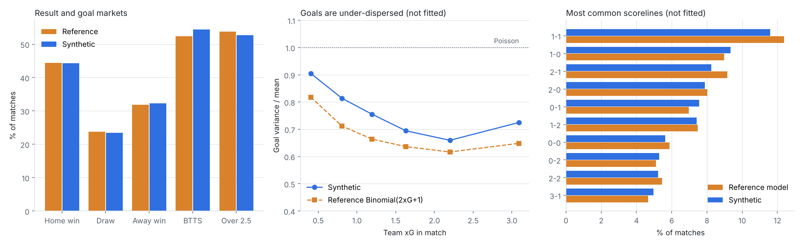

# matchgen — a calibrated synthetic football league

A generator of **fictional but football-realistic** match data at event level: 20 invented clubs, 500 invented players, a full 380-match season with every pass, carry, take-on, shot, foul, card and substitution, all with pitch coordinates and timestamps.

It is built for the *Inside the Game* developer hackathon, where projects must use synthetic, football-realistic data. "Realistic" here is measured, not asserted: the league reproduces the scoring, result and goal-dispersion patterns of a modern top-flight league, checked on 7,600 matches the calibration never saw. See [VALIDATION.md](../VALIDATION.md).



## Why this exists

No dataset is supplied, so every project needs its own. Most synthetic generators make data that *looks* like football. This one is tuned against league-level reference rates and validated out of sample, so analysis, narratives and AI agents built on it behave the way they would on the real game: a 1–0 is about as common as it should be, a side that dominates on xG still loses sometimes, and goals are under-dispersed, as they are in reality.

## Quick start

```bash
pip install -r requirements.txt
python -m matchgen.season --out data          # one season, ~40 s
python -m pytest -q                            # invariant tests
python -m matchgen.validate --seasons 20       # rebuild VALIDATION.md (~2.5 min on 2 cores)
```

```python
import pandas as pd
events = pd.read_csv("data/events.csv.gz")
match = events[events.match_id == "M001"].sort_values("event_id")   # replay in clock_s order
goals = events[(events.type == "shot") & (events.outcome == "goal")]
```

## Exploring the data

Two ways in:

- **Replay a match in the terminal.** `python scripts/replay.py` lists notable matches. `python scripts/replay.py M059` gives the key moments of Eskmouth 4-3 Dunhallow, add `--all` for every event, or `--live 20` to play it back at 20x speed.
- **The guided notebook.** Open `notebooks/explore.ipynb` in VS Code or Jupyter and choose Run All. It covers the table and who was lucky, the hidden ground truth, an xG race chart, shot maps, player leaderboards, how playing style shows up in the stats, and a counter-attack rebuilt event by event.

## What's in `data/`

| File | Contents |
|---|---|
| `events.csv.gz` | ~570k events with coordinates, clock, xG, possession ID and running score |
| `possessions.csv.gz` | Every possession, labelled `counter_attack`, `high_turnover`, `set_piece`, `sustained`, … |
| `matches.csv`, `lineups.csv` | Fixtures, results, xG, venues, referees, attendances; who played and for how long |
| `team_match_stats.csv`, `player_match_stats.csv` | Box-score aggregates (possession, PPDA, xG, xA, key passes, defensive actions) |
| `standings.csv`, `standings_by_matchweek.csv` | Final table and the table after every round |
| `clubs.csv`, `players.csv`, `referees.csv` | The fictional world: styles, formations, squads, attributes |
| `ground_truth_club_ratings.csv` | The engine's hidden true strength of each club, for testing whether your analysis can tell skill from luck |

Full column definitions: [docs/SCHEMA.md](SCHEMA.md).

## How it works

1. **World.** Twenty clubs with a playing style (possession, high press, counter, direct, wing play, balanced), a formation and attack/defence strength. Squads of 25 with roles and attributes.
2. **Match engine.** A match is a sequence of possessions. The ball moves by passes, carries and take-ons; each action can be lost, end in a foul or stoppage, or, in the final third, create a chance. Pass accuracy depends on distance, zone, team quality and the opponent's pressing. Style changes tempo, directness, width and counter-attacking.
3. **Shots.** A chance becomes a shot at a sampled location (cross, cut-back, through ball, combination, dribble, long shot). xG comes from a logistic model on distance and angle, with header and one-on-one adjustments. A shot scores with probability 0.9826 × xG, matching the reference finding that xG slightly overstates goals.
4. **Game state.** Leading teams sit deeper and create less; trailing teams push. Red cards weaken the side reduced to ten.
5. **Laws of the game.** A defending foul inside the box is a penalty, never a free kick (defenders rarely risk one there). Two yellows mean a red, and suspensions follow red cards and yellow-card accumulation.
6. **Ball continuity.** Each action starts where the last one ended. Assisting passes start where their type implies (crosses from wide, cut-backs from the byline, through balls from behind the line), which matters for spatial narration.
7. **Season.** Double round robin with realistic dates and kick-off times, team selection with rotation, and suspensions for red cards and yellow-card accumulation.

## Calibration

Only three engine knobs are fitted (`matchgen/calibrate.py`): the base chance rate (to total xG), a home factor (to the home/away xG split) and the strength spread between clubs (to the draw rate). Results, both-teams-to-score, over 2.5, scorelines, goal dispersion and per-match texture (shots, corners, cards, passes, ball-in-play time) are **not** fitted and serve as out-of-fit checks.

The published season is chosen by a fixed rule (`matchgen/pick_seed.py`): among 20 candidate seeds, the one closest to the reference rates. A single season otherwise wanders by several percentage points through ordinary sampling noise.

## Data provenance

- Every club, player, referee and stadium is fictional. Nothing is derived from real match records.
- The reference rates are league-level summary parameters (average xG, result shares, goals-per-xG, a goal-dispersion model) fitted separately on historical top-flight xG data. No match-level data is included or redistributed.

## Layout

```
matchgen/
  world.py       clubs, styles, formations, squads
  pitch.py       geometry, zones, xG model
  engine.py      event-level match simulation
  season.py      fixtures, team selection, suspensions, CLI
  export.py      CSV output and aggregate tables
  metrics.py     league metrics, dispersion, reference scoreline model
  calibrate.py   fits the three knobs
  validate.py    builds VALIDATION.md and the chart
  pick_seed.py   chooses the published season
scripts/         replay.py: a terminal match replay
notebooks/       explore.ipynb: a guided tour of the data
tests/           invariants (scores match goal events, coordinates in bounds, clock monotonic, ball continuity,
                 assist geometry, determinism)
docs/            schema and validation chart
data/            the published season
```
